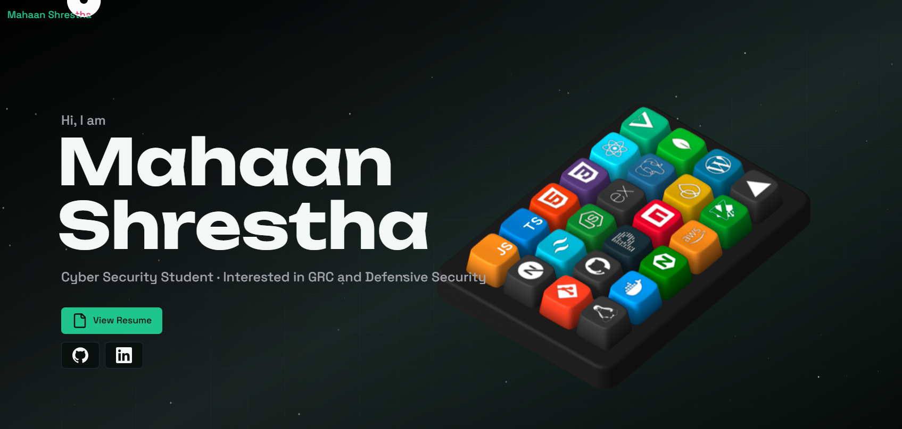

# Mahaan Shrestha - Portfolio

Personal portfolio website for **Mahaan Shrestha**, a BSc (Hons) Ethical Hacking and Cyber Security student interested in defensive security, GRC, web development and security automation.

## About this project

This website was adapted from an open-source 3D portfolio template. The personal information, projects, learning history, certifications, blog content, visual customisation and CMS configuration in this repository belong to Mahaan Shrestha.

## Features

- Interactive 3D keyboard and motion effects
- Responsive portfolio sections
- Projects, certifications, blog and newsletter content
- Contact form with messages stored for administrator review
- Supabase-backed content management and administrator authentication
- Inline editing controls for authenticated administrators
- Reduced-motion support

## Technology

- Next.js 14, React and TypeScript
- Tailwind CSS, GSAP and Motion
- Spline 3D
- Supabase authentication, database and storage
- Docker support

## Local development

1. Install dependencies with `npm install`.
2. Copy `.env.example` to `.env.local` and add your Supabase project URL and publishable key.
3. Run `npm run dev -- --port 3003`.
4. Open `http://localhost:3003`.

## Docker

Run `docker compose up --build`, then open `http://localhost:3003`.

## Contact

- Email: [sthamahaan55@gmail.com](mailto:sthamahaan55@gmail.com)
- GitHub: [Mahaan749](https://github.com/Mahaan749)
- LinkedIn: [Mahaan Shrestha](https://www.linkedin.com/in/mahaan-shrestha/)
